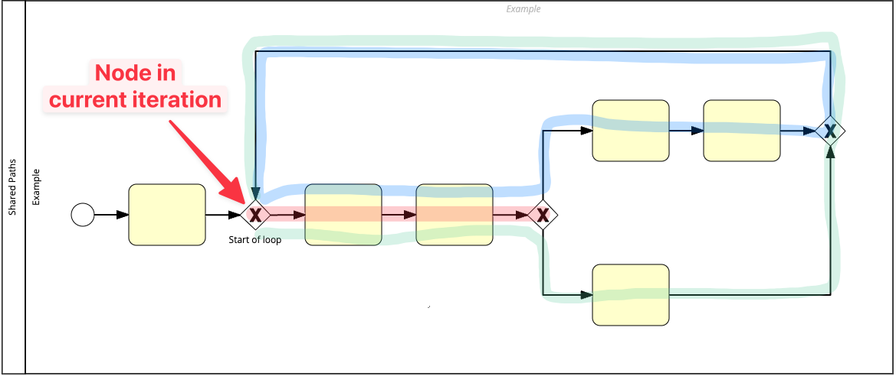

# Assigning Columns to Nodes

The second transformation step involves the [`ColumnPositioner`](../../diagramforge/transformation/column_positioner.py) class. This class assigns each node to a column based on their relationships and a predefined set of rules. Below is a detailed explanation in sequence of the methods and attributes used in the column assignment process.

## Table of Contents <!-- omit in toc -->
- [Initialization](#initialization)
- [Orchestration method](#orchestration-method)
- [Extract BFS with levels](#extract-bfs-with-levels)
- [Recalculate columns to achieve human-readable BPMN](#recalculate-columns-to-achieve-human-readable-bpmn)
  - [Overview of the `RuleBook` and its rules](#overview-of-the-rulebook-and-its-rules)
    - [Clarification: Placed vs. pushed back](#clarification-placed-vs-pushed-back)
    - [Rule 0 (fail safe): Node is skipped if it is already placed](#rule-0-fail-safe-node-is-skipped-if-it-is-already-placed)
    - [Rule 1: Node has no predecessors](#rule-1-node-has-no-predecessors)
    - [Rule 2: Place node if all predecessors are placed](#rule-2-place-node-if-all-predecessors-are-placed)
    - [Rule 3: Shared paths](#rule-3-shared-paths)
    - [Rule 4: Place after non-cyclic predecessors](#rule-4-place-after-non-cyclic-predecessors)
    - [Rule 5: Place after non placed junction predecessor](#rule-5-place-after-non-placed-junction-predecessor)
    - [Rule 6: Place after highest cyclic predecessors in the same cycle](#rule-6-place-after-highest-cyclic-predecessors-in-the-same-cycle)
    - [Rule 7: Place after highest cyclic predecessors in different cycles](#rule-7-place-after-highest-cyclic-predecessors-in-different-cycles)
    - [FALLBACK](#fallback)


## Initialization

Similar to the Preparation Tool, the `__init__` method of this class only initializes the instance without taking further actions - those are called in the [DiagramForge Class](../../diagramforge/diagramforge.py#L79). The class is initialized with the previously created graph as argument.

This class is initialized with the following attributes:
- `graph (nx.MultiDiGraph)` - The directed graph representing the BPMN diagram

During its runtime, the class will populate the following attributes - see methods for details:
- bfs_with_levels
- graph_cycles_sorted_desc
- bpmn_adjusted_columns

## Orchestration method
> Method: `position_columns`

#### Inputs <!-- omit in toc -->
  - `self.graph (nx.MultiDiGraph)` - The graph this class is initialized with

#### Outputs <!-- omit in toc -->
  - `bpmn_adjusted_columns: (Dict[str, List[str]])` - A dictionary with the levels (columns) as keys and the nodes assigned to that level as values of a list

---

This method orchestrates the column assignment process by calling `get_bfs_with_levels` and `recalculate_columns`, both described in detail below.

## Extract BFS with levels
> Method: `get_bfs_with_levels`

#### Inputs <!-- omit in toc -->
  - `self.graph (nx.MultiDiGraph)` - The graph this class is initialized with

#### Outputs <!-- omit in toc -->
  - `bfs_with_levels: (Dict[str, List[str]])` - A dictionary with the levels (columns) as keys and the nodes assigned to that level as values of a list. This is the first iteration of the column assignment process.

---

Using a classic Breadth-First Search (BFS) algorithm, this method assigns each node to a level (column) based on their relationships. The method returns a dictionary with the levels as keys and the nodes assigned to that level as values of a list.

## Recalculate columns to achieve human-readable BPMN
> Method: `recalculate_columns`

#### Inputs <!-- omit in toc -->
  - `self.graph (nx.MultiDiGraph)` - The graph this class is initialized with
  - `bfs_with_levels: (Dict[str, List[str]])` - The dictionary generated previously

#### Outputs <!-- omit in toc -->
  - `bpmn_adjusted_columns: (Dict[str, List[str]])` - A dictionary with the levels (columns) as keys and the nodes assigned to that level as values of a list. Now in its final version.

---

This method uses a queue to iterate over all nodes that were assigned a column in the last step. It then recalculates the columns based on the relationships of the nodes and a predefined set of rules. During this process, the source for the queue (`bfs_with_levels`) is updated continuously and the process stops when there are no more nodes left to assign to a column.

It starts by setting the current level (=column) to 0 and initializes the queue with the nodes that have no predecessors, ideally, which is also level 0 in the previously generated `bfs_with_levels`. It also initializes a set to keep track of the nodes that have already been placed.

```python
level = 0
level_nodes_queue = deque(self.bfs_with_levels[level])

placed_nodes = set()
```

Next, the method initializes the `while`-loop over the queue and takes the left-most node from the current level for which the column is to be recalculated.

```python
while level_nodes_queue:
    node: str = level_nodes_queue.popleft()
```

To facilitate as well as outsource the decision process for the column assignment, the [`RuleBook`](../../diagramforge/transformation/rule_book.py) class is used to determine the column for the current node. The rules of that class are applied in a specific order using simple if statements to ensure the exclusive and exhaustive nature of the rules. In other words, each node can only be assigned to one column, and at the end of the process, all nodes must be assigned to a column by one specific rule.


### Overview of the [`RuleBook`](../../diagramforge/transformation/rule_book.py) and its rules

An instance of this class is created for each node and iteration of the aforementioned `while`-loop. The `RuleBook` class is initialized with the following attributes:

- `G (nx.MultiDiGraph)` - The graph representing the BPMN diagram
- `graph_cycles_sorted_desc (List[List])` - A list of cycles in the graph sorted in descending order by length
- `bfs_with_levels (Dict[str, List[str]])` - Reference to the dictionary used in the ColumnPositioner class
- `node (str)` - The node for which the column is to be recalculated
- `bpmn_adjusted_columns (Dict[int, List[str]])` - Reference to the dictionary used in the ColumnPositioner class
- `placed_nodes (Set[str])` - Reference to the set used in the ColumnPositioner class
- `level (int)` - The current level (=column) of the node

All these parameters are required to determine whether a node should be placed at the given level or pushed back to a later iteration. Hence, the rules described below yield one of three possible outcomes:

 - ***Node is skipped***: The rule does not apply to this node and therefore skips so the next rule can be checked.
 - ***Node is placed***: The rule applies to this node and assigns it to the current or another calculated level.
 - ***Node is pushed back***: The rule recognizes that the node cannot be placed at the current level and pushes it back to a later iteration.
  
#### Clarification: Placed vs. pushed back

Placing a node means that the column position has been determined with confidence. The result is that the respective node is removed from the queue and added to the `placed_nodes` set. The final result is that this node is removed from `bfs_with_levels` and by that from the queue and placed in the `bpmn_adjusted_columns` dictionary at its final column index.

Pushing back a node means that the column position is not yet determined with confidence. The intermediate result is that the respective node is added back to the queue via appending it to `bfs_with_levels` at the current level + 1 or current level + n depending on the rule. Since the queue is fed by the `bfs_with_levels` dictionary, the node will be processed again in a later iteration.

Apart from this, the class implements a number of helper and `@property` methods. Please see the in-code documentation for more details on these.

---

#### Rule 0 (fail safe): Node is skipped if it is already placed

Making sure that a already placed node is not processed again.

#### Rule 1: Node has no predecessors

Quite straight forward, if the node has no predecessors, it is placed at the current level.

#### Rule 2: Place node if all predecessors are placed

If the node's predecessors are all placed, the current level of the given node is compared to the levels of its predecessors. If the node's level is higher than the levels of its predecessors, the node is placed at the current level. If the node's level is lower than the levels of its predecessors, the rule does not apply (= `return False`).

#### Rule 3: Shared paths

Now it is getting more complex. The major issue for any placement logic is how to deal with loops, especially with nested ones and in high quantities. 

This rule aims at finding a sensible breakpoint for the start of any loop. For that matter, it checks for "shared paths" among the nodes in the loop. Loops that the current node is part of. Here is an example:



Among the possible paths (blue and green) of the loop from one gateway to another, the nodes highlighted in red are shared among those paths. If something like that is found, this rules tries to set the longest shared path available. Primarily, this serves the purpose to find a "logical entry" to loops.

There is a helper method `__find_maximal_combinations` which tries to find the longest shared path among the nodes in the loop.

In case a shared path is found, the nodes of that path are set starting from the node of the current iteration at the current level and then incrementing the level by one for the rest of the nodes.

#### Rule 4: Place after non-cyclic predecessors

A non-cycling or non-looping predecessor is a predecessor that is not part of a loop mentioned in the list of loops `graph_cycles_sorted_desc`. This rule searches all predecessors and looks out for those that are not part of any loop and are already placed. For instance, a closing gateway typically has multiple predecessors and one might fit the criteria.

At this stage, the previous rules have sorted out the option of "normal" placed predecessors as well as shared paths. Hence, this is a try to find an anchor for a sensible placement of the node. In case there are any placed and non-cyclic predecessors, the node is placed at the level of the highest predecessor's level + 1.

#### Rule 5: Place after non placed junction predecessor

With the previous rule ruling out all placed predecessors, this rule tries to find a junction node that is not placed yet. The premise here is that there are placed but cyclic predecessors. A junction node is a node that has more than one successor. The idea is to find a junction node that is not placed yet and place the current node after that.

However, there are two possible outcomes. The first one is that there is a placed and looping predecessor that is also a junction node, or more than one of them. In that case, the lowest level of those predecessors is taken and the node is placed at that level + 1. This ensures a more natural way of placing nodes as in resembling a split after a gateway.

The second outcome is that there is one or more junction nodes but there are not yet set. In that case, the node is pushed back to the `bfs_with_levels` dictionary at the highest level of the junction nodes + 1. That level is taken from the `bfs_with_levels` dictionary as well instead of the `bpmn_adjusted_columns` dictionary. This is to ensure that the node is processed again in a later iteration.


#### Rule 6: Place after highest cyclic predecessors in the same cycle

If all rules above did not apply so far, it gets tricky to find a sensible placement. This rule checks whether there are predecessors of the current node that are part of the same cycle. If so, the node is placed at the highest level of the predecessors + 1.

#### Rule 7: Place after highest cyclic predecessors in different cycles

Conversely to the previous rule, this rule checks for predecessors that are part of different cycles. If so, the node is placed at the highest level of the predecessors + 1. This is a rare scenario but might occur in complex diagrams, for instance, when gateways are used to merge different logical parts of the diagram that run in parallel without sharing a common path.


#### FALLBACK

This is an indication that something went wrong. Nothing happens here except for the log. If a node arrives here, it is pushed back the the final `else` statement into the `bfs_with_levels` dictionary at the current level + 1. This should not happen too often and therefore `FORGE_CONFIG.COLUMN_POSITIONING_MAX_ITERATIONS` sets the limit for how many levels can be iterated over.


Finally, with all nodes placed, the method returns the `bpmn_adjusted_columns` dictionary with the final column assignment and the job of the `ColumnPositioner` class is done.