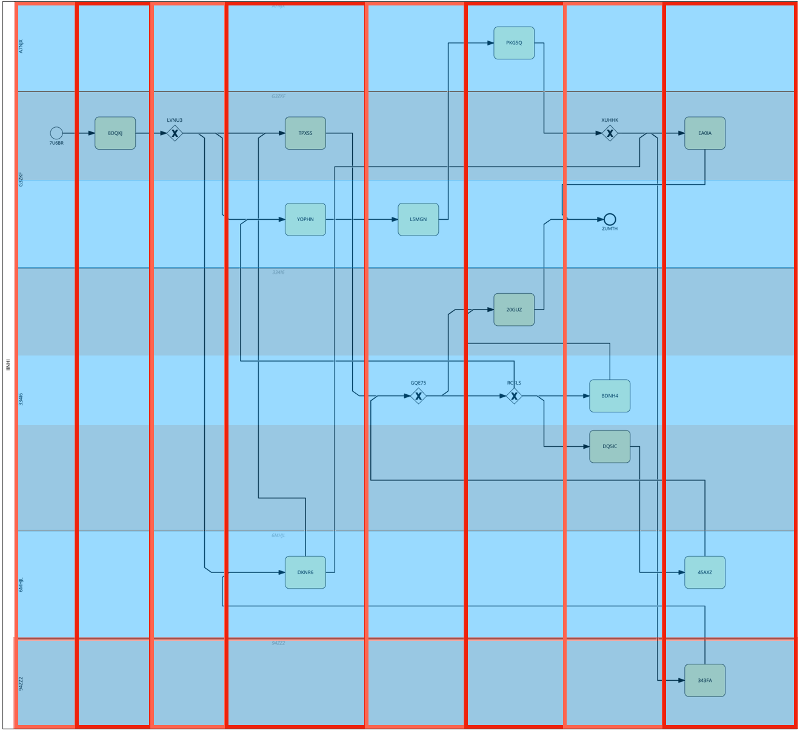
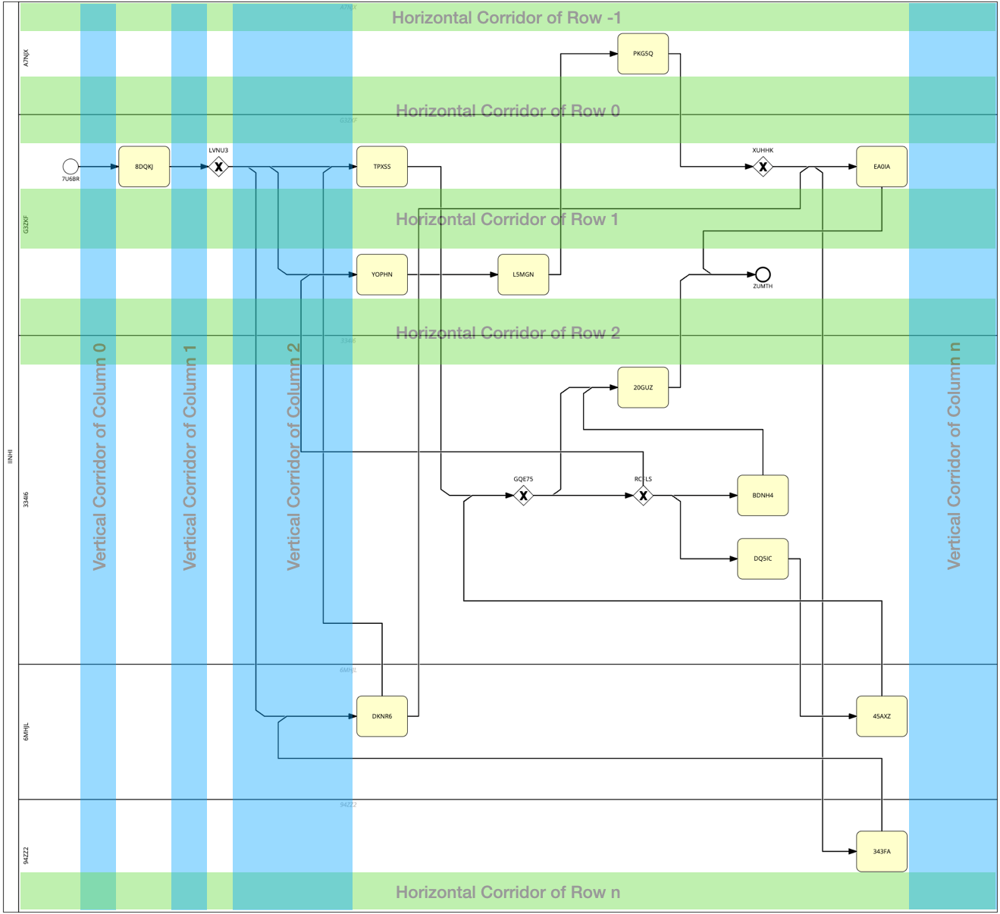
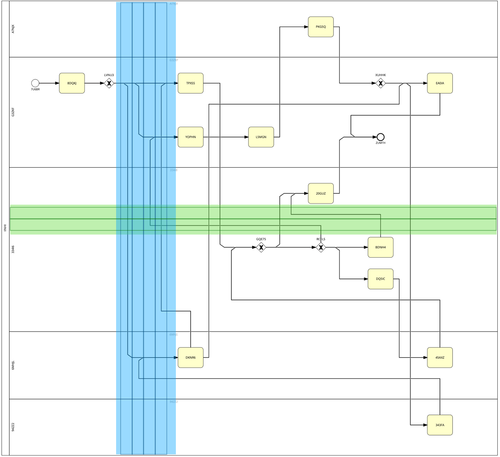
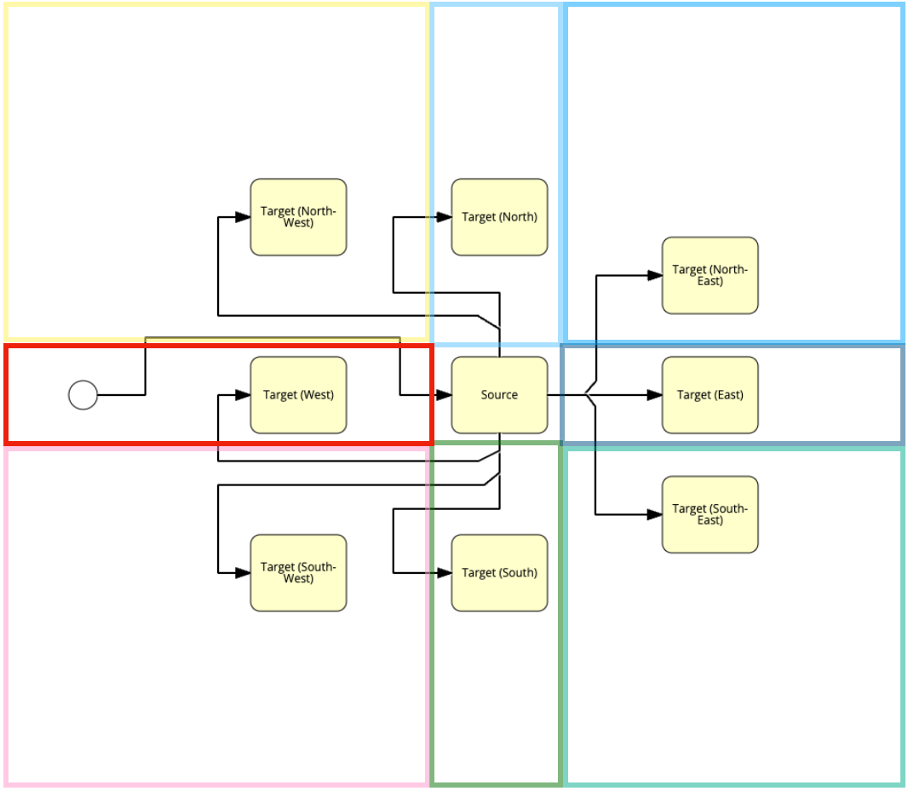

# Sequence Flow Positioning

Positioning the Associations of a BPMN diagram is the last major step. This process encompasses the most components in the codebase, hence the following covers all of these components first before diving into the details of the process.

## Table of Contents <!-- omit in toc -->
- [Used Components](#used-components)
  - [`CoordinatesHandler`](#coordinateshandler)
  - [`GlobalGridLookup`](#globalgridlookup)
  - [`SequenceFlowManager`](#sequenceflowmanager)
  - [`FlowCorridorManager`](#flowcorridormanager)
  - [`VerticalCorridor`](#verticalcorridor)
  - [`VerticalCorridorLane`](#verticalcorridorlane)
  - [`HorizontalCorridor`](#horizontalcorridor)
  - [`HorizontalCorridorLane`](#horizontalcorridorlane)
  - [`PortAdapter`](#portadapter)
  - [`PortConnection`](#portconnection)
  - [`LabelPlacer`](#labelplacer)
- [Sequence Flow Positioning Process](#sequence-flow-positioning-process)
  - [1. Create the port adapter mapping](#1-create-the-port-adapter-mapping)
  - [2. Instantiate the flow corridors](#2-instantiate-the-flow-corridors)
  - [3. Calculate the dockers](#3-calculate-the-dockers)
  - [4. Place the labels](#4-place-the-labels)

## Used Components

The following components are used in the sequence flow positioning process:

### [`CoordinatesHandler`](../../diagramforge/rendering/coordinates_handler.py) 
Described in more detail [here](../concept/global_coordinates.md).

### [`GlobalGridLookup`](../../diagramforge/rendering/flows/global_grid_lookup.py)
Described in more detail [here](../concept/global_coordinates.md).

### [`SequenceFlowManager`](../../diagramforge/rendering/flows/sequence_flow_manager.py)

The `SequenceFlowManager` is main actor in orchestrating the positioning of the sequence flows.

It is initialized with the following parameters:
- `source_graph (nx.MultiDiGraph)`: The graph representation of the BPMN diagram.
- `diagram (Diagram)`: The diagram object containing all the elements of the BPMN diagram.
- `resource_id_to_shape_mapping (Dict[str, ShapeBase])`: A mapping of the resource IDs to the corresponding BPMN shapes.
- `global_grid_lookup (GlobalGridLookup)`: The global grid lookup object.
- `coordinates_handler (CoordinatesHandler)`: The coordinates handler object.

Within the `JSONBuilder`, the `SequenceFlowManager` calls:

- `build_port_adapter_mapping` to build the port adapters and map out all connections in relation to their source.
- `build_flow_corridors` to instantiate the flow corridors.
- `calculate_docker` to calculate dockers for each sequence flow.

All of these are explained in more detail below.

### [`FlowCorridorManager`](../../diagramforge/rendering/flows/flow_corridor_manager.py)

To explain the `FlowCorridorManager`, let's take a look at the a sample diagram and its structure within the Diagram Forge:

The image above illustrates the columns and rows in which BPMN elements (nodes) are placed in, with red outlines and blue shaded boxes respectively. Height and width vary due to different spacers, like the onces in between lanes, but most importantly, the columns and rows also encompass the [vertical corridors](#verticalcorridor) and [horizontal corridors](#horizontalcorridor) that are used to position the sequence flows.

The `FlowCorridorManager` is responsible for creating and managing these corridors. It is initialized with the following parameters:
- `global_grid_lookup (GlobalGridLookup)`: The global grid lookup object.
- `coordinates_handler (CoordinatesHandler)`: The coordinates handler object.

Its main function is to build and keep track of the used corridors, which is done in the `vertical_corridors_by_col` and `horizontal_corridors_by_row` attributes. These are dictionaries that map the column or row number to the corresponding corridor. The respective corridors are always tied to the column left to it or to the row above it as depicted in the image below.

The only exception to this rule is the first corridor located at index `-1` since there is no row above but it is still possible that flows will pass above the nodes in row `0`. This does not apply to columns.

Both, the vertical as well as the horizontal corridors, are split into [vertical corridor lanes](#verticalcorridorlane) and [horizontal corridor lanes](#horizontalcorridorlane) respectively. Theoretically and practically, the space each corridor occupies is space where 1 to n sequence flows could be located. Consequently, the idea behind the corridors lanes is to organize that space and prevent sequence flows from overlapping as well as possible.

The image above shows an example for corridor lanes in a vertical and a horizontal corridor. Each lane is is keeping track of its own "used space" so the corridor classes can determine where to place the sequence flows.

### [`VerticalCorridor`](../../diagramforge/rendering/flows/vertical_corridor.py)

Vertical corridors are used to position sequence flows between columns. They are initialized with the following parameters:

- `from_col (int)`: The column number from which the corridor starts.
- `coordinates_handler (CoordinatesHandler)`: The coordinates handler object.
- `global_grid_lookup (GlobalGridLookup)`: The global grid lookup object.

It keeps track of lanes used in this corridor in the `active_vertical_lanes (List[VerticalCorridorLane])` attribute.

The most important methods here are:
- `get_available_vertical_corridor_lane`: Returns a newly created or existing vertical corridor lane that has enough space for the sequence flow based on the passed parameters.
- `check_lane_availability` used in the method above to determine if a lane has enough space for the sequence flow.
- `add_vertical_corridor_lane` to add a new lane to the corridor.

In addition to these, there are numerous helper methods to determine the width of the corridor, the end x-coordinate, etc.

### [`VerticalCorridorLane`](../../diagramforge/rendering/flows/vertical_corridor_lane.py)

Part of the vertical corridor, the vertical corridor lane is used to keep track of the space used by sequence flows. It is initialized with the following parameters:

- `lane_start_x (AuxCoordX)`: The starting x-coordinate of the lane.

The lane keeps track of its own busy sections in the `busy_sections (List[Tuple[int, int, V_CORRIDOR_LANE_BUSY_DIRECTION]])` attribute. In addition, it has a number of helper and property methods to determine various aspects of the lane, e.g. the width or the end x-coordinate.

A few more explanations on the `busy_sections` attribute:

- The `V_CORRIDOR_LANE_BUSY_DIRECTION` is an enum that is used to determine the direction in which the lane is busy. It can be either `V_CORRIDOR_LANE_BUSY_DIRECTION.UP` or `V_CORRIDOR_LANE_BUSY_DIRECTION.DOWN`.
- A requested space for a sequence flow is represented by a tuple `(start_x, end_x, direction)` where `start_x` and `end_x` are the x-coordinates of the start and end of the sequence flow and `direction` is the direction in which the sequence flow is going.
- The `BUSY_SECTION_PERSPECTIVE` is used to determine the perspective of the start to the end (source to end node). This is important to set the angled sections of the sequence flow correctly.

### [`HorizontalCorridor`](../../diagramforge/rendering/flows/horizontal_corridor.py)

Horizontal corridors are used to position sequence flows between rows. They are initialized with the following parameters:

- `from_row (int)`: The row number from which the corridor starts.
- `coordinates_handler (CoordinatesHandler)`: The coordinates handler object.
- `global_grid_lookup (GlobalGridLookup)`: The global grid lookup object.

It keeps track of lanes used in this corridor in the `active_horizontal_lanes (List[HorizontalCorridorLane])` attribute.

The most important methods here are:
- `get_available_horizontal_corridor_lane`: Returns a newly created or existing horizontal corridor lane that has enough space for the sequence flow based on the passed parameters.
- `check_lane_availability` used in the method above to determine if a lane has enough space for the sequence flow.
- `add_horizontal_corridor_lane` to add a new lane to the corridor.

In addition to these, there are numerous helper methods to determine the height of the corridor, the end y-coordinate, etc.

### [`HorizontalCorridorLane`](../../diagramforge/rendering/flows/horizontal_corridor_lane.py)

Part of the horizontal corridor, the horizontal corridor lane is used to keep track of the space used by sequence flows. It is initialized with the following parameters:

- `lane_start_y (AuxCoordY)`: The starting y-coordinate of the lane.

The lane keeps track of its own busy sections in the `busy_sections (List[Tuple[int, int, H_CORRIDOR_LANE_BUSY_DIRECTION]])` attribute. In addition, it has a number of helper and property methods to determine various aspects of the lane, e.g. the height or the end y-coordinate.

A few more explanations on the `busy_sections` attribute:
- The `H_CORRIDOR_LANE_BUSY_DIRECTION` is an enum that is used to determine the direction in which the lane is busy. It can be either `H_CORRIDOR_LANE_BUSY_DIRECTION.LEFT` or `H_CORRIDOR_LANE_BUSY_DIRECTION.RIGHT`.
- A requested space for a sequence flow is represented by a tuple `(start_y, end_y, direction)` where `start_y` and `end_y` are the y-coordinates of the start and end of the sequence flow and `direction` is the direction in which the sequence flow is going.
- The `BUSY_SECTION_PERSPECTIVE` is used to determine the perspective of the start to the end (source to end node). This is important to set the angled sections of the sequence flow correctly.

### [`PortAdapter`](../../diagramforge/rendering/flows/port_adapter.py)

The `PortAdapter` is used to map out all connections in relation to their target. It is initialized with the following parameters:

- `bound_shape (Union[Task, Event, Gateway])`: The shape to which the port adapter is bound.
- `global_grid_lookup (GlobalGridLookup)`: The global grid lookup object.
- `all_outgoing_connections (List[PortConnection])`: A list of all outgoing connections from the shape.

Each shape that has incoming or outgoing connections is assigned four ports: North, East, South, and West. The N, E, and S ports serve outgoing connections, whereas the W port serves incoming connections. A connection is represented by a `PortConnection` (see below).

The `PortAdapter` is responsible for assigning connections to each port based on specific rules. Assigning these connections follow the order depicted in the image below.

Every color represents the cardinal direction stated in the respective Task objects. Furthermore, this is also a quick overview how sequence flows are laid out based on the relative position from source to target node.

All connections to and from a port are stored in the attributes:

- `north_connections (List[PortConnection])`
- `east_connections (List[PortConnection])`
- `south_connections (List[PortConnection])`
- `west_connections (List[PortConnection])`

respectively. Outgoing connections undergo a sorting process to ensure the least amount of overlaps for better readability. Please see the in-code documentation of the method `__assign_order_to_outgoing_connections` for more information. The sorting process mainly focuses on simpler diagrams since the assumptions is that the more complex the diagram, the more likely it is that the sequence flows will overlap. Furthermore, complex diagrams or complex sections in diagrams are less frequent overall.

### [`PortConnection`](../../diagramforge/rendering/flows/port_connection.py)

The `PortConnection` is used to represent a connection between two shapes. It is initialized with the following parameters:

- `source (str)`: The ID of the source shape.
- `association (Association)`: The association object which also contains the target shape's ID.
- `global_grid_lookup (GlobalGridLookup)`: The global grid lookup object.

This is rather a helper class to keep track of the information of a connection. It stores:

- `possible_label_y_positions (List[float])`: A list of possible x-coordinates for the label of the connection.
- `used_vertical_corridor_lanes (List[VerticalCorridorLane])`: A list of vertical corridor lanes used by the connection.
- `used_horizontal_corridor_lane (List[HorizontalCorridorLane])`: A list of horizontal corridor lanes used by the connection.

for later operations in the sequence flow positioning process.

### [`LabelPlacer`](../../diagramforge/rendering/flows/label_placer.py)

The `LabelPlacer` is used to place labels that are not enclosed by their node (e.g., Gateway or Sequence Flow labels) relative to their respective elements following a set of rules. It is initialized with the following parameters:

- `coordinates_handler (CoordinatesHandler)`: The coordinates handler object.
- `association_resource_id_to_port_connection_mapping (Dict[str, PortConnection])`: A mapping of the association resource IDs to the corresponding port connections.
- `shape_resource_id_to_port_adapter_mapping (Dict[str, PortAdapter])`: A mapping of the shape resource IDs to the corresponding port adapters.
- `flow_corridor_manager (FlowCorridorManager)`: The flow corridor manager object.
- `global_grid_lookup (GlobalGridLookup)`: The global grid lookup object.
- `resource_id_to_shape_mapping (Dict[str, ShapeBase])`: A mapping of the resource IDs to the corresponding BPMN shapes.

Similarly to sequence flows, the labels are placed based on the relative position of the source and target nodes. The `LabelPlacer` is looking for suitable positions for the labels based on each sequence flow's layout. A general rule is that the label should be placed on top of the sequence flow in the first corner it encounters when moving from the source to the target node.

Moreover, the `LabelPlacer` is also responsible for placing the labels of gateways. This process is much easier since the labels are placed on a fixed position relative to the gateway.

## Sequence Flow Positioning Process

### 1. Create the port adapter mapping
> Done by `SequenceFlowManager.build_port_adapter_mapping()` in the `JSONBuilder`

As previously described, this process creates `PortAdapter` objects for every node with at least one connections. Then, it collects all connections and sorts them into their respective ports while also creating `PortConnection` objects for each connection.

### 2. Instantiate the flow corridors
> Done by `SequenceFlowManager.build_flow_corridors()` in the `JSONBuilder`

This process creates the vertical and horizontal corridors with all vital coordinate points such as their start and end points. Each column and row of the diagram is assigned a vertical and horizontal corridor respectively.

### 3. Calculate the dockers
> Done by `SequenceFlowManager.calculate_docker()` in the `JSONBuilder`

Here comes the fun part. With all the preparations done that are described above, the actual positioning of the sequence flows can start. The `SequenceFlowManager` iterates over all connections in the specified order and calculates the dockers for each sequence flow. Determining the order of connections previously serves as guardrails to prevent overlaps.

Depending on the nature of a connection, it can be laid out through multiple vertical and horizontal corridor. The minimum is 0 corridors, which only applies to connections that connect a source to it target directly. This means that both must be located on the same row and no other nodes are in between. 

The maximum are 3 corridors. For all types of connections, this works as follows:
1. The connection exits its source node and enters the vertical corridor.
   - If the target node is located in a higher numbered column, the vertical corridor of the source node's column is used.
   - If the target node is located in the same or a lower numbered column, the vertical corridor of the source node's column -1 is used.
2. Then, the connection travels to the target node's row.
   - If the target node is located in the same or a higher numbered row, the horizontal corridor of the target node's row is used.
   - If the target node is located in a lower numbered row, the horizontal corridor of the target node's row -1 is used.
3. In that horizontal corridor, the connection travels to the target node's column - 1 (since all incoming connections are managed through the W port). In this column, the connections enters the target node.

Throughout this process, all corridors request available lanes within themselves to prevent overlaps. The amount of dockers created also various based on the nature of the connection as well as the configuration. Aside from direct connections that have no dockers, here is an overview of the possible amount of dockers created for a connection:

> ⚠️ All mentioned dockers might be 2 dockers instead of 1 based on the config and the logic. Some corners must have an angle to show the direction of the sequence flow, which is why 2 dockers are created.

- East-bound connections:
  - If the target node is located in the next column, there is 1 source angled and 1 target angled docker.
  - If the target node is located in  any column after the next, there is 1 source angled, 1 source-horizontal-corridor, 1 target-horizontal-corridor, and 1 target angled docker.
- South-bound and north-bound connections: All connections have 1 source-horizontal-corridor, 1 target-horizontal-corridor, and 1 target angled docker.

With that, the process of placing sequence flows is concluded.

### 4. Place the labels
> Done by `LabelPlacer.place_sequence_flow_labels()` and `LabelPlacer.place_gateway_labels()` in the `JSONBuilder`

The final step is to put the labels of sequence flows and gateways where they belong. The labels of sequence flows are placed on top of the sequence flow in the first corner it encounters when moving from the source to the target node. The labels of gateways are placed on a fixed position relative to the gateway - both as described above in the `LabelPlacer` section.

This concludes the entire process of placing sequence flows in a BPMN diagram. 